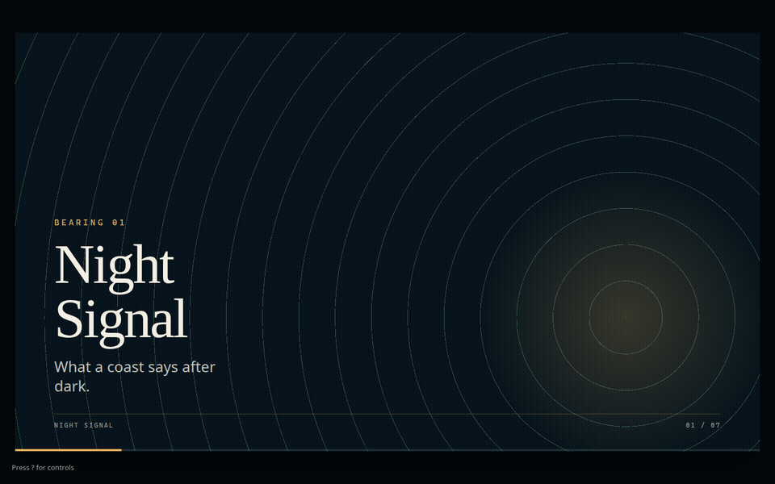
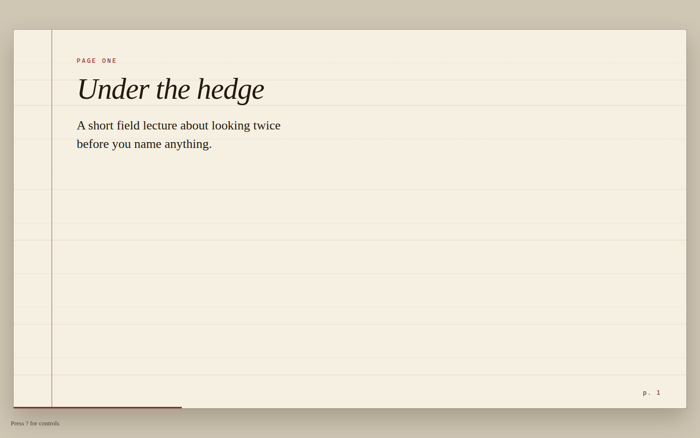

# presagent

A single HTML file of slides. [presagent](engine/presagent.js) is the behaviour: a 16:9 stage, hash deep links, the keyboard, speaker notes, a presenter window, local video, YouTube, an audio-output picker, and a screen wake lock in fullscreen. The deck is the look. There is no build step and no runtime dependency.

`SKILL.md` is the guide for a coding agent. This file is the human version.




## Quick start

```bash
python3 -m http.server 8000 --bind 127.0.0.1
```

Open [http://127.0.0.1:8000/examples/night-signal/](http://127.0.0.1:8000/examples/night-signal/) and press `?`.

On a Mac, double-click `serve.command` in the repo or inside a deck folder. On Windows, double-click `serve.bat`. Both serve on `127.0.0.1:8000` and open the deck. The speaker picker and the wake lock need that secure context; opening the file directly usually will not switch audio outputs. The slide number stays in the URL either way (`#4`).

To start a talk, copy `template/` and edit `slides.js` and `theme.css`. Point `index.html` at `engine/presagent.js`. Agents should follow `SKILL.md` rather than restyling the engine.

## Keys

| Key | Action |
| --- | --- |
| ← / → | Previous / next slide |
| Space | Play or pause a clip, or next slide |
| PgUp / PgDn | Previous / next slide |
| Home / End | First / last slide |
| F | Fullscreen |
| N | Speaker notes |
| P | Presenter view (allow pop-ups) |
| S | Audio output |
| ? or H | This list |
| Esc | Close overlays |

The presenter window shows the current section, the cue notes, the next slide, and a timer. Keys pressed there drive the main window. Notes are short cues (`cueNotes`). A longer `narration` field is never shown.

## Browser support

Chrome and Edge have the full set, including `HTMLMediaElement.setSinkId` and the screen wake lock. Safari can present, but it cannot switch audio output from the page: the picker says so, and you change the system output, then reload. The slide number is still in the URL. Other browsers without `setSinkId` get the same message. The wake lock is skipped quietly when the API is missing or the page is not a secure context.

## A second theme

Field Notes uses the same engine and none of the same markup. Its stage is 1920×1080. Night Signal’s is 1600×900. Both scale to the window the same way.



## Layout

```
SKILL.md                 agent guide
engine/presagent.js      behaviour
engine/presagent.mjs     optional ES module entry
engine/presagent-base.css
template/                starter deck, plus serve scripts
examples/night-signal/   text, image, video, YouTube, custom type
examples/field-notes/    a different theme
tests/smoke.spec.js      Playwright
```

## Deploy

Any static host works: GitHub Pages, Vercel, Netlify. There is no build command. Serve the repo root so the decks can see `engine/`. Keep bundled video small (the demo clip is about 60 KB). A long recording belongs on the host or on YouTube, not in git. The speaker picker and the wake lock need HTTPS in production.

## Attribution

The lens drawing, the leaf drawing, and `examples/night-signal/assets/beacon.mp4` were made for this repository and are under the same MIT license. The YouTube slide embeds Georges Méliès’ 1902 film *A Trip to the Moon* (*Le Voyage dans la Lune*), which is in the public domain. The embed is the upload cited by [Wikidata Q244971](https://www.wikidata.org/wiki/Q244971) (YouTube id `GXwbM_vOvb0`). The film is not included in this repo.

## Tests

```bash
npm test
```

The GitHub Actions workflow runs the same Playwright smoke tests: no console errors, hash and keys, help, notes, presenter sync in both directions, the speaker picker, and a stubbed fullscreen wake lock.

## Licence

MIT. Copyright 2026 G-J van Rooyen. See [LICENSE](LICENSE).
