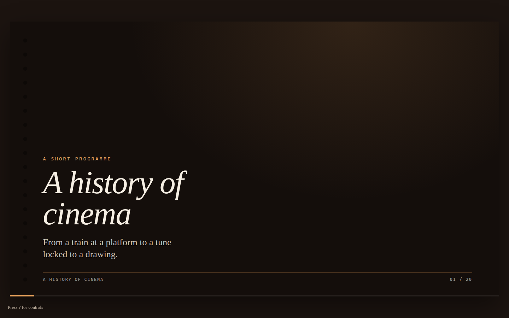
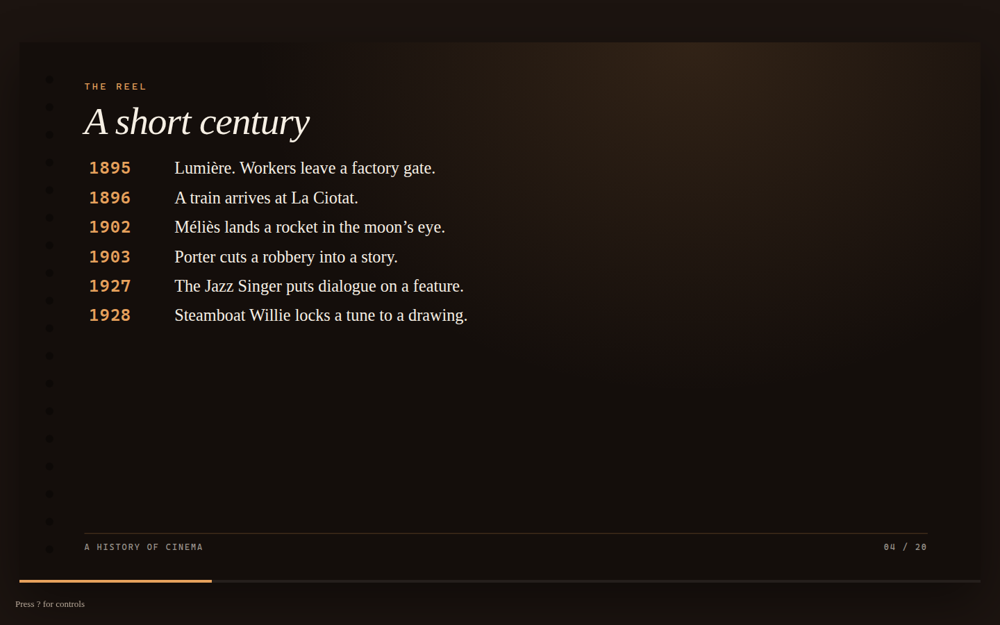
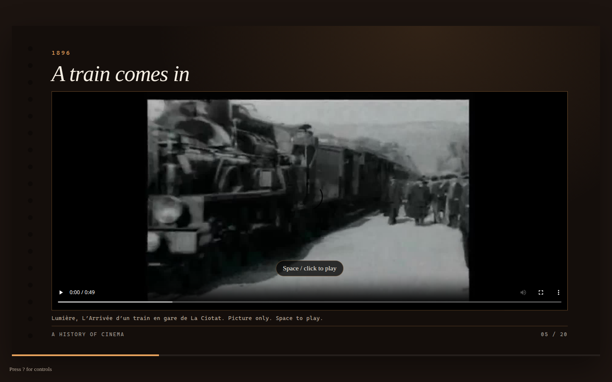
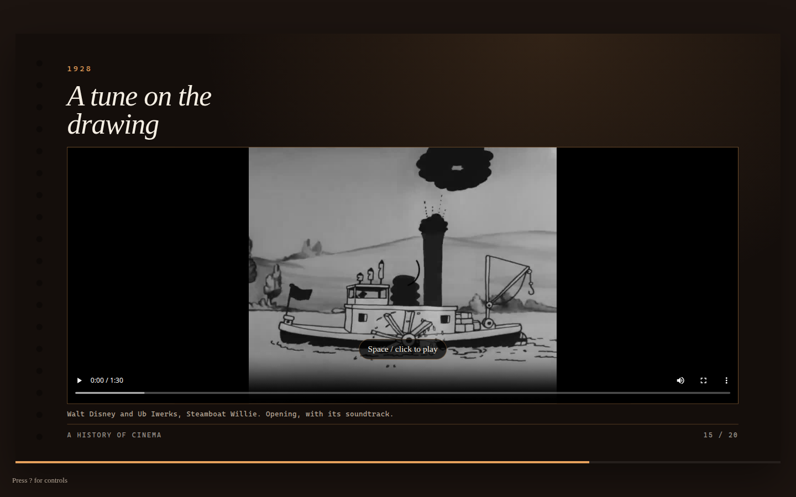

# presagent — HTML presentations, built by your coding agent

presagent is an agent skill for quickly creating full HTML, CSS, and JavaScript presentations. A deck plays straight from a local folder: no build step, no dependencies. The same files deploy to Vercel, Netlify, GitHub Pages, or any other static host.

The engine supplies the behaviour: keyboard control, hash deep links, speaker notes, a presenter window, local video and YouTube playback, an audio-output picker, and a screen wake lock in fullscreen. The agent designs a completely custom look.

## Try it

Paste this to any coding agent:

```
Use the skill at https://github.com/gvrooyen/presagent to create a 20-slide presentation on the history of cinema. Include at least three creative-commons videos of 30-180 seconds each as illustration. At least one should include audio.
```

The deck that prompt produces in this repo is [examples/history-of-cinema/](examples/history-of-cinema/). Licences, source URLs, and trim ranges are in [CREDITS.md](examples/history-of-cinema/CREDITS.md).









## Quick start

```bash
python3 -m http.server 8000 --bind 127.0.0.1
```

Open [http://127.0.0.1:8000/examples/history-of-cinema/](http://127.0.0.1:8000/examples/history-of-cinema/) and press `?`.

On a Mac, double-click `serve.command` in the repo or inside a deck folder. On Windows, double-click `serve.bat`. Both serve on `127.0.0.1:8000` and open the deck. The speaker picker and the wake lock need that secure context. Opening the file directly usually will not switch audio outputs. The slide number stays in the URL either way (`#4`).

To start a different talk, copy `template/` and edit `slides.js` and `theme.css`. Point `index.html` at `engine/presagent.js`. Agents should follow `SKILL.md` and leave the engine’s behaviour alone.

## Keys

| Key | Action |
| --- | --- |
| ← / → | Previous / next slide |
| Space | Play or pause a clip, or next slide |
| PgUp / PgDn | Previous / next slide |
| Home / End | First / last slide |
| F | Fullscreen |
| N | Speaker notes |
| P | Presenter view (allow pop-ups) |
| S | Audio output |
| ? or H | This list |
| Esc | Close overlays |

The presenter window shows the current section, the cue notes, the next slide, and a timer. Keys pressed there drive the main window. Notes are short cues (`cueNotes`). A longer `narration` field is never shown.

## Browser support

Chrome and Edge have the full set, including `HTMLMediaElement.setSinkId` and the screen wake lock. Safari can present, but it cannot switch audio output from the page: the picker says so, and you change the system output, then reload. The slide number is still in the URL. Other browsers without `setSinkId` get the same message. The wake lock is skipped quietly when the API is missing or the page is not a secure context.

## Layout

```
SKILL.md                      agent guide
engine/presagent.js           behaviour
engine/presagent.mjs          optional ES module entry
engine/presagent-base.css
template/                     starter deck, plus serve scripts
examples/history-of-cinema/   the sample talk, with CREDITS.md
tests/smoke.spec.js           Playwright
```

## Deploy

Any static host works: GitHub Pages, Vercel, Netlify. There is no build command. Serve the repo root so a deck can see `engine/`. Keep bundled video modest. A long recording belongs on the host or on YouTube, not in git. The speaker picker and the wake lock need HTTPS in production.

## Tests

```bash
npm test
```

The GitHub Actions workflow runs the same Playwright smoke tests: no console errors, hash and keys, help, notes, presenter sync in both directions, local video, the speaker picker, and a stubbed fullscreen wake lock.

## Licence

MIT. Copyright 2026 G-J van Rooyen. See [LICENSE](LICENSE). The three films in the cinema example stay under the public-domain terms in [CREDITS.md](examples/history-of-cinema/CREDITS.md).
